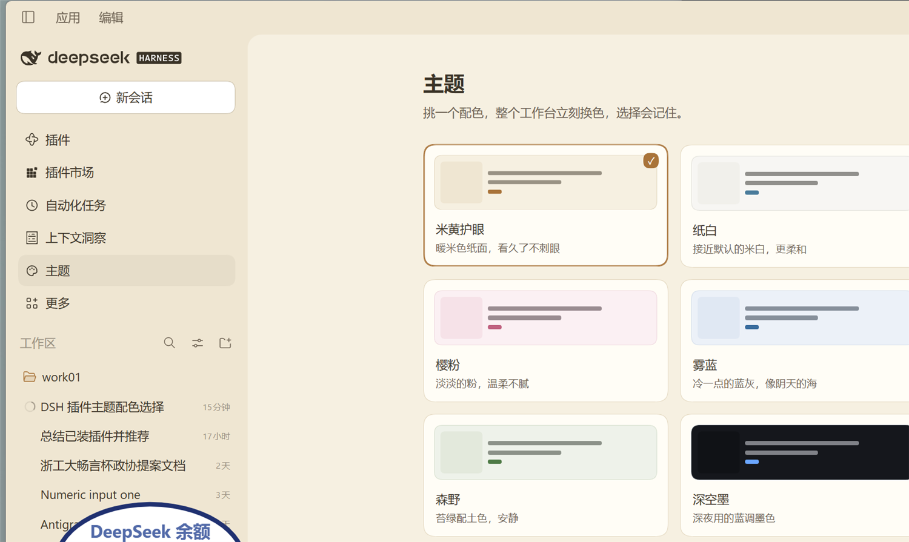
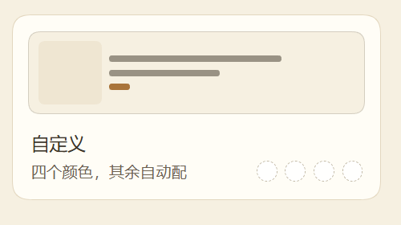
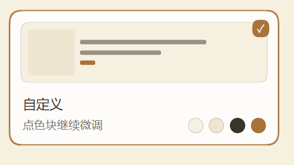

# dsh-theme

给 DSH 工作台加一个左侧栏入口，一屏配色卡，点一下就整套界面换色。默认带「米黄护眼」在内的 8 套配色，最后一张卡片可以自己调色。

GitHub：https://github.com/17855880027WuYutao/dsh-theme　　Gitee：https://gitee.com/wu-yutao17855880027/dsh-theme

## 用法

1. 左侧栏点「主题」（调色盘图标）。
2. 点任意一张配色卡，整个工作台立刻换色，选中项右上角打勾。
3. 想去掉，点底部的「恢复默认外观」，会回到你之前在「设置 → 外观」里选的浅色 / 深色 / 系统。

选择记在浏览器 localStorage 里，重启 DSH 后会自动恢复上次的配色。

## 自定义配色

网格最后一张是「自定义」。还没调过时，点它会把当前这套配色复制过来，然后卡片右下角出现四个色块：

| 色块 | 管什么 |
| --- | --- |
| 纸色 | 整个工作台底色 |
| 侧栏 | 左侧栏底色 |
| 文字 | 正文与标题颜色 |
| 强调 | 主按钮、链接、焦点环 |

点色块打开系统取色器，选完立刻生效。行、层、边框、次要文字、悬停底色、气泡、滚动条这些不让人挑，按你选的四个色自动混出来；文字和纸面对比度不够时会自动往深或往浅挪一档。纸色挑成深色时，整套界面按深色盘派生。

还没调过的时候四个点是虚线占位：

调好之后就是这样，选中的配色右上角打勾：

## 配色

| id | 名字 | 说明 |
| --- | --- | --- |
| beige | 米黄护眼 | 暖米色纸面，看久了不刺眼 |
| paper | 纸白 | 接近默认的米白，更柔和 |
| mint | 薄荷 | 一点点绿的浅底 |
| sakura | 樱粉 | 淡淡的粉，温柔不腻 |
| ocean | 雾蓝 | 冷一点的蓝灰，像阴天的海 |
| coffee | 咖啡 | 棕调暖色，像旧书页 |
| forest | 森野 | 苔绿配土色，安静 |
| ink | 深空墨 | 深夜用的蓝调墨色（深色盘） |

## 实现方式

- 换色走 `ctx.theme.overrideTokens('dsh-theme', { token: { light, dark } })`，只叠一层 alias token，不改内置主题注册，也不碰别人的偏好。
- 覆盖的 token 约 30 个：底色 / 层 / 边框 / 文字 / 品牌色 / 状态色 / 气泡 / 滚动条 / 聚焦环 / 阴影等。
- 每套配色自带浅色或深色属性，激活时会顺带把「外观」偏好切到对应模式（`theme.setTheme`），这样没被覆盖到的 token 也跟随合适的底色；点「恢复默认外观」时还原成原来的偏好。
- 纯客户端插件，Host 端 `apply()` 是空的。

## 卸载

`plugin_manager` 里移除 bundle 即可；如果卸载时还停在某个配色上，建议先在面板里点「恢复默认外观」。
